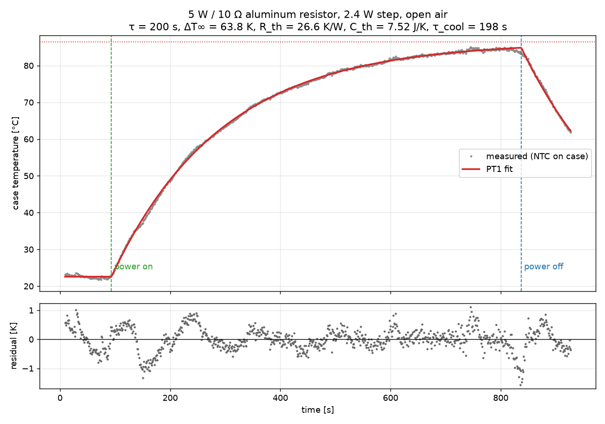
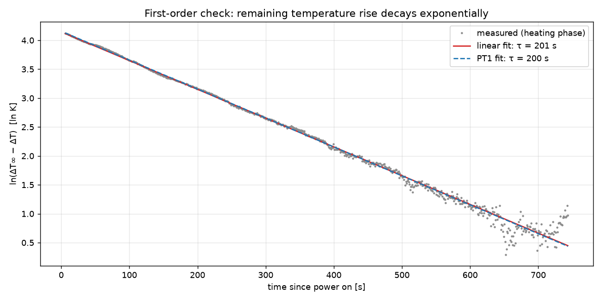
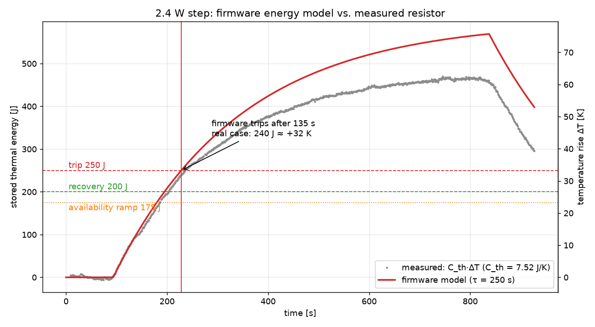
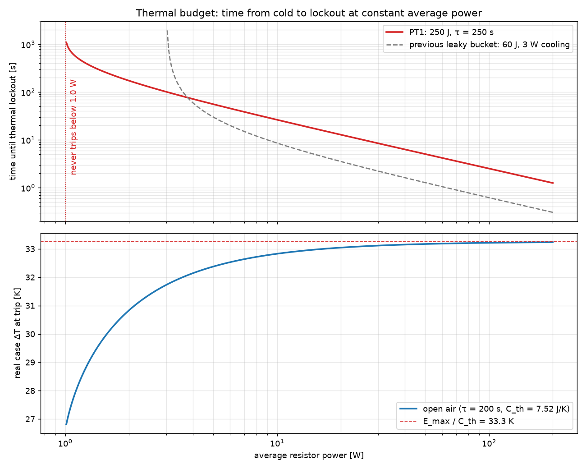
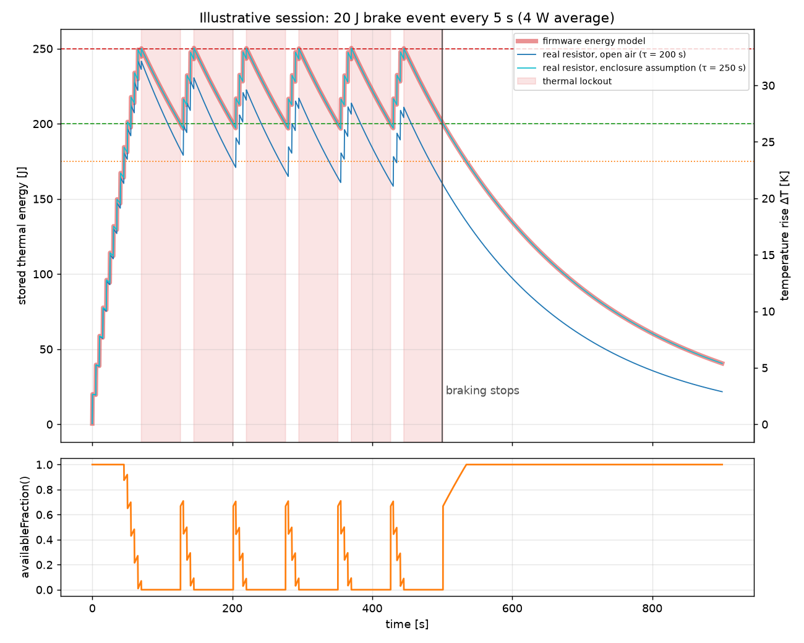

# Brake Resistor Thermal Model

The brake resistor dissipates the regenerative energy of the servo when the pedal is
pushed back fast. The firmware (`ESP32/include/PredictiveBrakeController.h`) does not
measure the resistor temperature; it estimates it with a thermal energy model and locks
the resistor out before it overheats. This folder contains the measurement and the
analysis used to parameterize that model.

| Folder | Content |
|---|---|
| `data/` | Raw step-response log (`time_s, r_ntc_kohm, temp_c`, 1 Hz) |
| `logger/` | ESP32 sketch that recorded the log (NTC voltage divider) |
| `scripts/` | Parameter identification and firmware-model simulation |
| `plots/` | Generated figures and `identified_parameters.json` |

## Resistor

5 W / 10 Ω aluminum-housed wirewound resistor (`5W-10R-LVKE`).

## Measurement setup

- Lab power supply at **5.00 V** (0.6 A current limit), resistor connected directly to the
  output terminals and lying in open air: 5² / 10 = 2.5 W nominal, **2.4 W** used as heating power.
- 100 kΩ NTC (B = 3950, 3D printer type) taped to the aluminum case with Kapton tape.
- ESP32 reads the NTC through a 47 kΩ pull-up to 3.3 V, 64x oversampling, one sample per
  second (`logger/ntc_temperature_logger.ino`).
- Power switched on at ~93 s, held for ~745 s (≈ 3.7 τ), then switched off. The cooling
  phase was recorded for another ~90 s.

Photo of the setup: `media/measurement_setup.jpg` (to be added).

The measured temperature is the **case surface** temperature. The resistive wire inside
heats up faster than the case; this is covered by the separate short-term pulse limits
(see below), not by the thermal energy model.

## Model

A first-order (PT1) thermal RC model, written in the stored thermal energy
`E = C_th · ΔT` (ΔT = temperature rise above ambient):

```
dE/dt = P_in − E / τ          τ = R_th · C_th
```

Passive cooling `E / τ = ΔT / R_th` is proportional to the temperature rise. A constant
power `P` settles at `E∞ = P · τ` (`ΔT∞ = P · R_th`).

## Identification

```
cd docs/brakeResistor/scripts
uv run thermal_identification.py      # fit, plots 01-02, identified_parameters.json
uv run firmware_thermal_model.py      # firmware simulation, plots 03-05
```

The scripts declare their dependencies inline (PEP 723), so `uv run` needs no setup.
With plain Python: `pip install numpy scipy matplotlib`, then `python <script>.py`.
`firmware_thermal_model.py` reads its constants directly from `PredictiveBrakeController.h`,
so the plots always show the current firmware parameters.

The heating and cooling phases are fitted together (ambient, ΔT∞, τ, power-on and
power-off times, and a separate cooling time constant):

| Parameter | Value |
|---|---|
| Ambient temperature | 22.6 °C |
| Steady-state rise ΔT∞ at 2.4 W | 63.8 K (→ 86.4 °C) |
| Time constant τ (heating) | 200 s |
| Time constant τ (log-linear check) | 201 s |
| Time constant τ (cooling) | 198 s |
| Thermal resistance R_th = ΔT∞ / P | 26.6 K/W |
| Thermal capacity C_th = τ / R_th | 7.5 J/K |
| Stored energy at steady state | 480 J |
| Fit residual (RMS) | 0.39 K |



The residual stays within about ±1 K, and heating and cooling give the same time
constant. A single PT1 element therefore describes the case temperature well. The
log-linear plot confirms this: the remaining temperature rise decays as a straight line
over 3.7 time constants.



The firmware comments use the earlier evaluation of the same measurement
(R_th = 26.3 K/W, C_th = 7.65 J/K, τ = 201 s). The difference is within the uncertainty
of the heating power and does not change the firmware parameters.

## Firmware parameters

The firmware does not know the start temperature or the mounting. It applies margins:

| Constant | Value | Rationale |
|---|---|---|
| `THERMAL_TAU_S_FL32` | 250 s | Measured 201 s in open air; +25 % for worse convection in an enclosure. Assumed cooling at the limit: 250 J / 250 s = 1.0 W. |
| `MAX_ENERGY_JOULES_FL32` | 250 J | ≈ 33 K rise, about half of the tested 480 J / 64 K steady state. Headroom for warm restarts, hot ambient and wire-to-case lag. |
| `RECOVERY_ENERGY_JOULES_FL32` | 200 J | Lockout ends below this level (20 % hysteresis) and not before the 3 s cooldown. |
| `AVAILABILITY_RAMP_START_01` | 0.7 | Above 175 J, the resistor share of the regen budget (`availableFraction()`) ramps from 1 to 0. The admittance strategy falls back to the servo's own regen budget before the lockout. |

Because τ_firmware ≥ τ_real, the firmware energy is always an overestimate of the real
energy for the same input power. Its temperature estimate is therefore conservative.

### Firmware model vs. measurement

The measured 2.4 W step fed into the firmware model: the firmware would trip after 135 s.
At that moment the real case has stored 240 J (≈ +32 K).



### Thermal budget

Time from a cold resistor to lockout at constant average power, compared with the
previous model (60 J budget, constant 3 W cooling):



- Average power below **1.0 W** never trips.
- Short, intense use gets about 4x more energy than before (250 J vs. 60 J) before the
  lockout.
- Sustained use between 1 W and ~3.5 W now trips (the previous model allowed up to 3 W
  forever). The measurement shows that 3 W in open air would settle at ~80 K rise.
- The real case rise at the trip point stays at or below E_max / C_th ≈ 33 K for any
  power.

### Lockout and recovery

Without new heating, the energy decays from 250 J to 200 J in
`τ · ln(250 / 200) ≈ 56 s`. That is the minimum lockout duration after a thermal trip
(the previous model needed ~3 s).

Illustrative hard-braking session (20 J brake event every 5 s, 4 W average): the resistor
trips after ~70 s and then cycles between ~56 s lockout and ~19 s available as long as the
braking continues. `availableFraction()` ramps down before each trip so the strategy
hands the regen back to the servo early.



## Limits of the model

- **Warm restart:** the energy starts at 0 after a reboot. If the MCU restarts right at
  the trip point, the real rise can reach roughly 2 · 33 K ≈ 67 K before the next trip
  (≈ 107 °C case at 40 °C ambient). This is the reason the budget is only half of the
  tested steady state.
- **Mounting:** the parameters come from one resistor in open air on a desk. A resistor
  in a closed housing, near the stepper motor or bolted to a heat sink behaves
  differently. The 25 % τ margin covers mildly worse convection only.
- **Wire-to-case lag:** the NTC sees the case. Fast high-power pulses heat the wire
  before the case follows. These are limited separately by `MAX_CONTINUOUS_ON_TIME_US`
  (80 ms full-on) and `THERMAL_COOLDOWN_TIME_US` (3 s), which are unchanged.
- **Power estimate:** the firmware computes the power from duty · V² / R with the bus
  voltage clamped to at least the learned rest voltage. A wrong resistor value in the
  pedal config (`setResistanceOhm`) scales the estimate directly.
